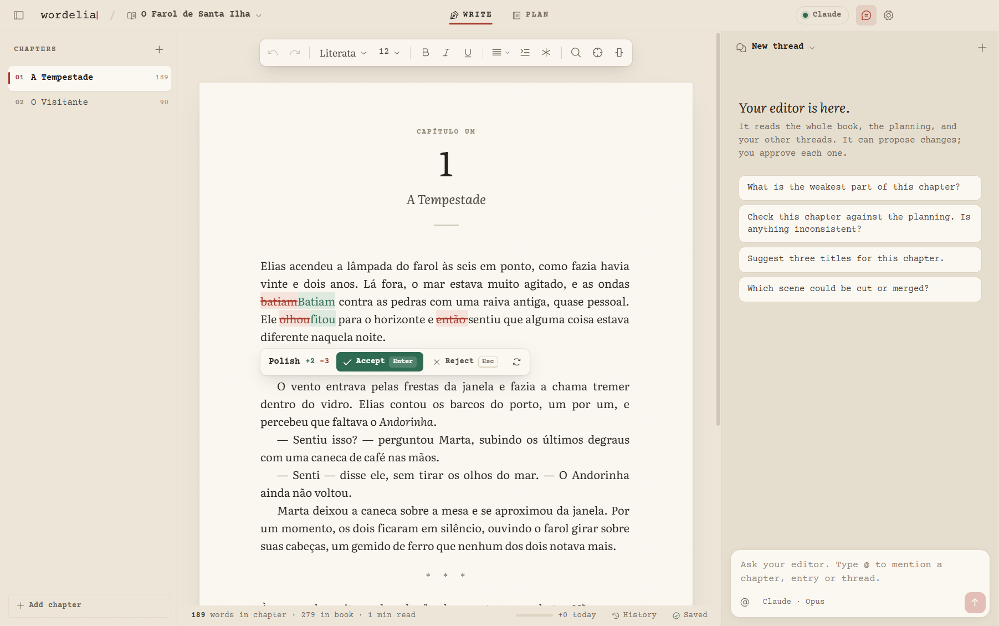
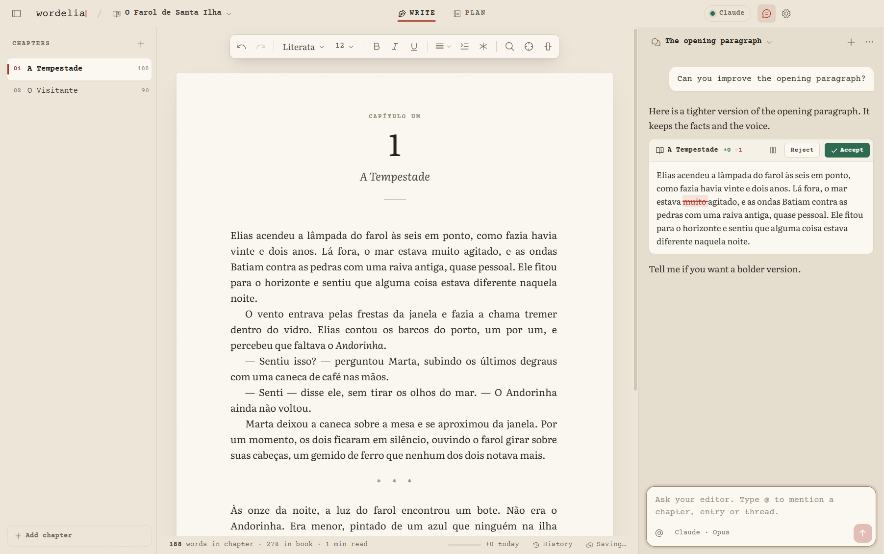
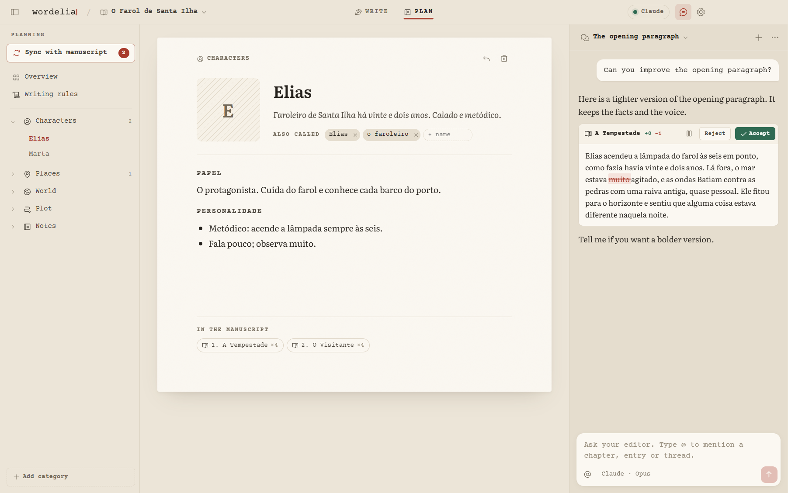
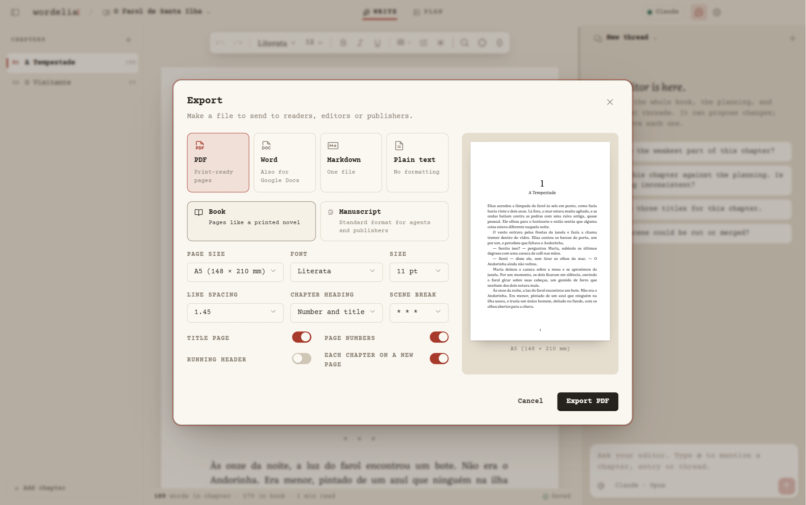
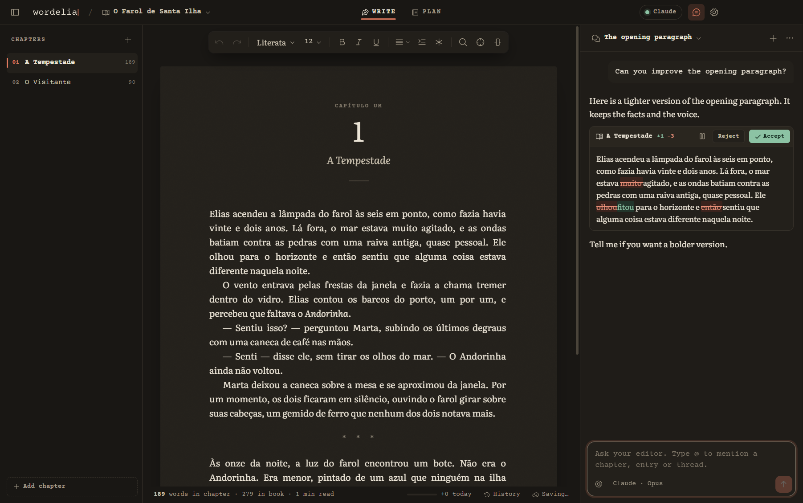
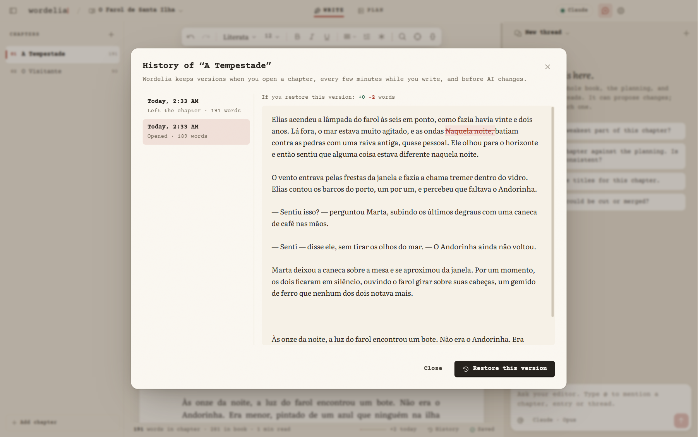
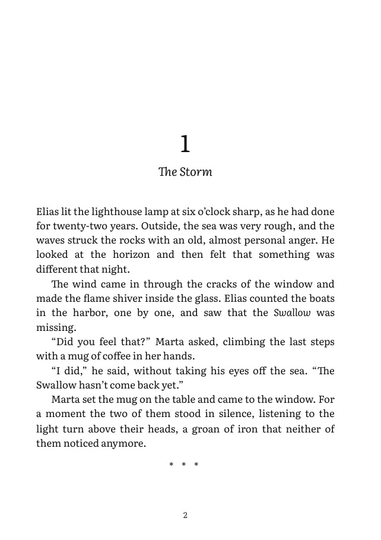

<p align="center">
  
</p>

<p align="center"><em>A quiet desk for your book, with an editor at your side.</em></p>

Wordelia is a desktop writing app for novelists. It looks like a simple word processor. An AI editor works beside you, like Cursor works beside a programmer. You write the book. The AI polishes, answers, remembers and keeps the story consistent. You approve every change.



## What it does

- **Write on a page.** Chapters are tabs in a sidebar. The page uses real book typography: first-line indents, justified text, scene breaks. Type `--` and get the dialogue dash.
- **Polish with one key.** Select text and press `Ctrl+J`. The AI rewrites the selection with your writing rules, and reads the text before and after it. The change shows on the page as a diff: red for removed words, green for new words. Press `Enter` to accept or `Esc` to reject.
- **Your own actions.** Polish, Tighten, Fix grammar only, Show don't tell, Expand — or write your own. Each action can use a different model.
- **Chat with an editor that knows the book.** The chat reads the manuscript, the planning and your other chat threads. It proposes changes as diff cards. You accept or reject each change.
- **Connected threads.** Keep one thread per character or per part of the plot. Each thread keeps a short digest. All threads read the digests of the others, so they do not contradict each other.
- **Plan the story.** Characters, places, world and plot, as notes with images and aliases. Each note shows where its names appear in the manuscript.
- **Sync the planning.** Press *Sync with manuscript*. The AI reads the chapters that changed and proposes new characters and new facts.
- **Never lose a word.** Wordelia saves as you type, keeps versions of each chapter (when you open it, every few minutes, and before every AI change), and lets you compare and restore them. Deleted chapters go to a trash folder in the book.
- **Small comforts.** A daily word goal, focus mode, typewriter scrolling, and optional typewriter sounds.
- **Import and export.** Import DOCX (from Google Docs or Word), Markdown or text. Export a print-ready PDF (book or standard manuscript format), a DOCX with real Word styles (Google Docs opens it without loss), Markdown or text.
- **Your files, your AI.** A book is a folder of Markdown files on your computer. Put it in Google Drive, OneDrive or git. Connect the AI that you already pay for.

| Chat with proposals | Planning |
|---|---|
|  |  |

| Export | Lamplight (dark) theme |
|---|---|
|  |  |

| Version history | A page of the exported PDF |
|---|---|
|  |  |

## Connect an AI

Wordelia is free. It uses an AI that you already have:

| Provider | What you need |
|---|---|
| **Claude Code** | A Claude Pro or Max plan. Install [Claude Code](https://claude.com/claude-code), then run `claude auth login` in a terminal. |
| **Codex** | A ChatGPT plan. Install the [Codex CLI](https://developers.openai.com/codex), then run `codex login` in a terminal. |
| **Anthropic API** | An API key from console.anthropic.com. |
| **OpenAI API** | An API key from platform.openai.com. |

Wordelia runs your own `claude` or `codex` program. It never reads or stores your login. API keys are encrypted with the key store of the operating system.

Open **Settings → AI** to choose a model for each task: chat, actions, planning sync and background work. Wordelia gets the model lists from the providers, so new models appear without an app update.

## A book is a folder

```
My Book/
  wordelia.json        title, author, chapter order, typography, export settings
  manuscript/          one Markdown file for each chapter
  planning/            Characters/, Places/, World/, Plot/, Notes/
  ai/                  writing rules, chat threads, sync state
```

The files are plain Markdown. Obsidian and git can read them.

## Develop

You need Node.js 22.12 or later (the project uses Node 24, see `.node-version`).

```bash
npm install
```

```bash
npm run dev
```

| Command | What it does |
|---|---|
| `npm run dev` | Start the app with hot reload. |
| `npm test` | Run the unit tests (Vitest). |
| `npm run typecheck` | Check the types of all processes. |
| `npm run shot -- book` | Build, start the app with a scripted AI, and save screenshots to `test-results/shots/`. |
| `npm run e2e` | Build and run all end-to-end scenarios (scripted AI, temporary data folders). |
| `npm run dist` | Make the Windows installer in `release/`. |

Read `CLAUDE.md` and `docs/` before you change the code: `docs/SPEC.md` (product), `docs/ARCHITECTURE.md` (design), `docs/ROADMAP.md` (status) and `GLOSSARY.md` (terms).
